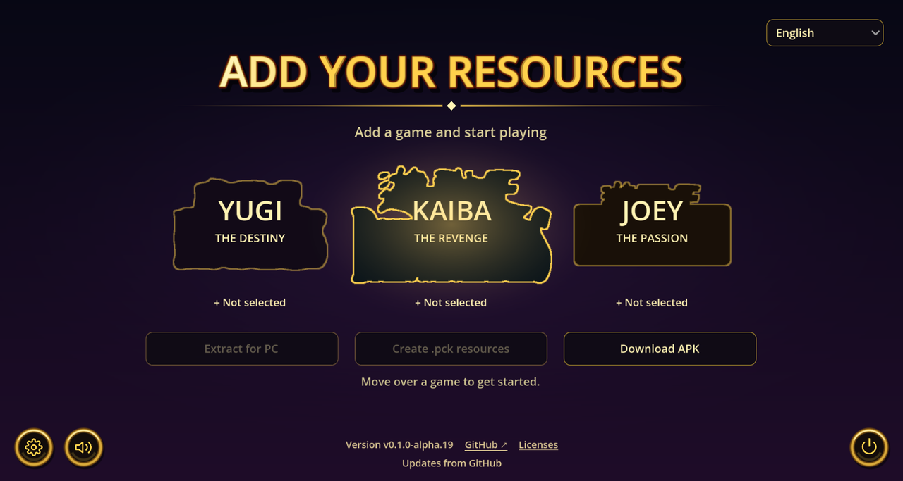

<p align="center">
  
</p>

# Yu-Gi-Oh! Power of Chaos Remake

[English](README.md) | **Español**

[](https://github.com/Johanfer12/Yu-Gi-Oh-Power-of-Chaos-Remake/releases/download/v0.1.0-alpha.23/PowerOfChaos.exe)

[](https://github.com/Johanfer12/Yu-Gi-Oh-Power-of-Chaos-Remake/releases/download/v0.1.0-alpha.23/PowerOfChaos-Android.apk)

**Descarga directa · Windows · Preliminar v0.1.0-alpha.23 · Sin ZIP**

**Tus juegos de Power of Chaos reunidos en un launcher moderno para Windows.**

## Contenido

- [Ventajas](#ventajas)
- [Ajustes del launcher](#ajustes-del-launcher)
- [Tus ISO → PC o APK para Android](#tus-iso--pc-o-apk-para-android)
- [Capturas del launcher](#capturas-del-launcher)
- [¿Qué es este remake?](#qué-es-este-remake)
- [Empezar en Windows](#empezar-en-windows)
- [Cómo funciona](#cómo-funciona)
- [Compatibilidad y límites actuales](#compatibilidad-y-límites-actuales)
- [Idiomas y voces](#idiomas-y-voces)
- [Ejecutar desde el código fuente](#ejecutar-desde-el-código-fuente)
- [Compilaciones automáticas](#compilaciones-automáticas)
- [Estado del proyecto y avisos](#estado-del-proyecto-y-avisos)
- [Crear tu APK Android](#crear-tu-apk-android)

## Ventajas

- **PC o Android desde el mismo launcher.** Prepara tus juegos para Windows u obtén el APK público Android junto con un paquete privado de recursos. Impórtalo una vez en Android y consérvalo al actualizar la aplicación.
- **Duelos en red en Joey sin DirectPlay.** La conexión moderna por red local sustituye ese componente antiguo de Windows. Conexión probada entre PC y PC, y entre PC y Android.
- **Portable.** Lleva juntos el EXE y su carpeta **`PoC Data`**: ahí viajan tus recursos, partidas y ajustes.
- **Recursos más livianos.** Las imágenes WebP sin pérdida y el audio OGG reducen el espacio ocupado. La biblioteca de Yugi probada ocupa aproximadamente **un 44% menos** que su versión convertida sin comprimir. El ahorro depende del juego y la edición.
- **Decoraciones para 16:9.** Los laterales decorados rodean el área de duelo original de 4:3 en las vistas compatibles de Yugi, Kaiba y Joey, cada uno con su propio fondo.
- **Todo en uno.** Yugi the Destiny, Kaiba the Revenge y Joey the Passion comparten un launcher. Puedes empezar con uno y añadir los demás cuando quieras.
- **Colección compartida, mazos separados.** Conserva tus cartas entre juegos con las compatibilidades originales: Yugi usa su catálogo, Kaiba también las de Yugi y Joey las de los tres. Cada título mantiene su mazo activo.
- **Elige el ritmo y la imagen.** Selecciona 30 FPS, 60 FPS o la frecuencia de tu monitor; aspecto estirado, 4:3 original o fondos decorativos; y velocidad normal o 2×.
- **Juego rápido opcional en los tres juegos.** Omite escenas de personajes, voces y barridos, conservando la música y los efectos. [Ver ajustes del launcher](#ajustes-del-launcher).
- **Las mismas opciones de juego en Android.** Aspecto, FPS, simulación, juego rápido y traducciones de cartas acompañan los controles táctiles, el scroll, el arrastre y la selección de sacrificios existentes.

## Ajustes del launcher

Abre el **engranaje** del launcher para elegir cómo jugar:

| Ajuste | Opciones |
|---|---|
| Aspecto | **Estirado** ocupa toda la ventana; **Original sin fondo** conserva el 4:3 con bandas negras; **Overlay** añade el fondo decorativo de cada duelo alrededor del área original 4:3. |
| FPS | **30**, **60** o **Display**, que sigue la frecuencia del monitor actual. |
| Simulación | **Normal** o **2×**. La velocidad de simulación es independiente del límite de FPS. |
| Juego rápido | Omite las escenas de entrada y salida, reacciones con retrato, voces y barridos entre escenas en **Yugi, Kaiba y Joey**. Conserva la música y los efectos de sonido. |
| Traducciones mejoradas | **Originales** o **Mejoradas (ES)**: nombres y descripciones en español para las **771 cartas**, con fuentes comunitarias públicas y adaptaciones que conservan los efectos originales. |

**Valores por defecto:** FPS del display, velocidad normal y juego rápido desactivado.

Las preferencias se recuerdan al volver a abrir el launcher. Juego rápido es opcional
y viene **desactivado**; desactívalo para recuperar la presentación original. El launcher
se abre maximizado desde el principio y puedes redimensionar la ventana o usar
**F11 / Alt+Enter** para alternar la pantalla completa.

**Traducciones mejoradas** es opcional y viene **desactivado**. Cubre los nombres y las descripciones en español de las **771 cartas** de los tres juegos, con bases comunitarias públicas y adaptaciones revisadas para conservar los efectos del inglés original. Los menús y las reglas del juego se conservan; es una mejora comunitaria, no un paquete de traducción oficial.

Actívalo con conexión para preparar el paquete local. La primera descarga es de aproximadamente **110 MB**; después, los textos funcionan sin conexión. Abrir el launcher no inicia descargas. Si la preparación falla, siguen disponibles los textos importados. Puedes desactivar la opción cuando quieras para recuperarlos.

## Tus ISO → PC o APK para Android

Selecciona los ISO o las carpetas instaladas de tus juegos y elige:

- **Extraer para PC** para preparar los juegos en Windows.
- **Crear recursos .pck** para preparar un **paquete privado de recursos `.pck`** generado desde tus juegos, que queda con su informe de validación en **`PoC Data/android/pck/`**. También puedes reutilizar los juegos ya preparados.
- **Descargar APK** para bajar de GitHub el APK público Android de esta versión.

**Android se prepara desde el launcher.** El APK público lo compila y firma GitHub Actions; el launcher genera el paquete de recursos en tu equipo. El flujo normal no requiere cuentas, SDK Android, JDK, configurar una firma ni acceder a la clave del autor. Instala el APK, ábrelo y selecciona tu `.pck` una vez. Las actualizaciones compatibles posteriores conservan esos recursos y tus partidas. [Preparar tus archivos Android](#crear-tu-apk-android).

Tus ISO y recursos convertidos permanecen en tu equipo; la descarga no incluye datos originales del juego. La conexión de Joey ya se probó entre **PC y PC**, y entre **PC y Android**. El proyecto continúa en alfa: agradecemos comentarios, errores y pruebas con otras ediciones y equipos.

## Capturas del launcher

**Biblioteca con los tres juegos preparados (interfaz en inglés)**


**Importa tus recursos y elige extraer para PC o crear un APK Android**



Las capturas muestran el launcher Windows. Los logos aparecen después de importar tus propias copias compatibles.

## ¿Qué es este remake?

Yu-Gi-Oh! Power of Chaos Remake es una reconstrucción experimental en Godot del motor de **Yugi the Destiny, Kaiba the Revenge y Joey the Passion**. Busca conservar las reglas, la presentación y la sensación de los originales, facilitando su uso y mantenimiento en PC modernos.

Tú aportas una copia compatible del juego que quieras usar. El launcher lee sus recursos en tu equipo y los prepara para el nuevo motor. **Basta con un juego para empezar.**

> **Versión preliminar:** el desarrollo y las pruebas de compatibilidad continúan. Todavía no es un reemplazo terminado y completamente fiel de todas las ediciones originales.

### Más funciones del launcher

- **Un solo EXE para Windows.** Incluye Godot, el conversor y 7-Zip; no necesitas instalarlos por separado.
- **Importación desde ISO o carpeta instalada.** Las imágenes compatibles se leen sin ejecutar sus instaladores ni los juegos originales.
- **Archivos locales.** Tus ISO, recursos y partidas no se suben a GitHub ni a un servicio de conversión.
- **Añade juegos sin empezar de nuevo.** Las importaciones posteriores conservan los juegos preparados y los guardados del remake.
- **Selector de idiomas.** Inglés, español, alemán, francés, italiano y japonés; el primer inicio toma un idioma compatible del sistema y recuerda tu elección.
- **Menú propio.** Música del launcher, controles dorados, icono propio y ajuste de volumen.
- **Motor en Godot.** Los recursos originales los aporta cada jugador por separado.

«Remake» se refiere a la reconstrucción del motor. No significa que se hayan redibujado las cartas ni vuelto a grabar las voces y la música originales.

## Empezar en Windows

1. [Descarga **`PowerOfChaos.exe`** directamente](https://github.com/Johanfer12/Yu-Gi-Oh-Power-of-Chaos-Remake/releases/download/v0.1.0-alpha.23/PowerOfChaos.exe). También hay compilaciones de desarrollo en [Actions](https://github.com/Johanfer12/Yu-Gi-Oh-Power-of-Chaos-Remake/actions/workflows/build-windows.yml).
2. Pon el EXE en una carpeta donde quieras guardar el launcher y tus partidas, y ábrelo.
3. En **SUBE TUS RECURSOS**, pasa el cursor por el juego que quieras añadir y elige **ISO** o **Carpeta**.
4. Selecciona una imagen de disco o carpeta instalada compatible, pulsa **Extraer para PC** y espera a que termine.
5. Haz clic en el logo del juego preparado para jugar. Puedes añadir los otros después.

La descarga es un único EXE, sin asistente de instalación. La primera importación prepara las herramientas incluidas en `PoC Data/tools/`; abrir el menú no espera esa extracción. Los archivos de Actions pueden venir en ZIP; los de Releases permiten descargar directamente el EXE.

Necesitas Windows con soporte para el renderizador OpenGL de compatibilidad de Godot, una copia compatible de al menos un juego y espacio libre para los recursos y archivos temporales. Una carpeta instalada debe contener `Data.dat`, `Voice.dat`, `Region.dat` y el ejecutable original correspondiente; este se lee para obtener tablas del motor, sin ejecutarlo.

## Cómo funciona

```text
Tu ISO o carpeta instalada
            |
 Validación y extracción local
            |
 Recursos convertidos en tu PC
            |
     Motor del juego en Godot
```

El EXE distribuido contiene el launcher, el motor y las herramientas de conversión. No incluye los ejecutables originales ni sus ilustraciones, voces o música de juego: se obtienen de la copia que selecciones.

La conversión valida y comprime una biblioteca temporal dentro de `PoC Data` antes de activarla en `PoC Data/resources/`. Al añadir un juego se conservan los ya importados. Tras completar el cambio se retira la copia generada anterior; tus ISO, carpetas originales y guardados no se sobrescriben. El importador rechaza revisiones no compatibles e imágenes dañadas o incompletas; no descarga recursos faltantes.

### Dónde queda cada archivo

| Archivos | Ubicación junto al EXE |
| --- | --- |
| Recursos WebP/OGG y datos del motor | `PoC Data/resources/` |
| Guardados del remake | `PoC Data/saves/` |
| Ajustes | `PoC Data/content.cfg` |
| Herramientas y licencias | `PoC Data/tools/` |
| Extracción temporal | `PoC Data/temp/` y carpetas transitorias dentro de `PoC Data/` |
| Último error de importación | `PoC Data/import-last-error.log` |

Si falla una importación, el launcher muestra el juego afectado, el archivo o carpeta, la etapa y la causa. La ventana permite **Copiar detalles** y **Abrir registro**; **Ver error** la vuelve a abrir. Un fallo general de conversión, compresión o escritura se identifica por su etapa y no se atribuye a una ISO sin evidencia.

**Mueve o respalda juntos `PowerOfChaos.exe` y `PoC Data`.** Las rutas relativas permiten cambiar de carpeta o unidad sin volver a importar. Usa una carpeta con permiso de escritura.

El launcher busca versiones en GitHub al abrirse. El botón circular de **actualizar**, junto al de encendido, sólo aparece cuando se detecta una versión más nueva. El pie muestra tu versión, el estado y vínculos a GitHub y licencias. Puedes descargar una nueva versión y reiniciar desde el launcher: se verifica su SHA-256 y se reemplaza únicamente el EXE, conservando `PoC Data`. La descarga se puede cancelar. Si falla el reemplazo o el inicio del nuevo proceso, se intenta restaurar el EXE anterior; el diagnóstico queda en `PoC Data/updates/last-update.log`. Las versiones alpha/beta también reciben preliminares; las estables siguen el canal estable. Requiere Windows, conexión y permiso de escritura en la carpeta del EXE.

Al actualizar en la misma carpeta se copian los antiguos `saves/` adyacentes sin reemplazar guardados portables más recientes. También se migran los ajustes anteriores y se prepara una copia compacta de la biblioteca importada. Se mantiene la fuente antigua hasta verificar la nueva. Si cambias de carpeta, lleva el antiguo `saves/` junto al nuevo EXE antes de abrirlo por primera vez, o mueve tu `PoC Data` existente.

## Compatibilidad y límites actuales

Esta versión pública está orientada a **Windows PC**.

| Juego | Importaciones comprobadas | Comprobaciones del motor |
| --- | --- | --- |
| Yugi the Destiny | ISO y carpeta compatibles | Inicio independiente del título y duelo normal |
| Kaiba the Revenge | ISO y carpeta compatibles | Inicio independiente del título y duelo normal; perfiles compatibles sin necesitar Yugi |
| Joey the Passion | ISO y carpeta compatibles | Inicio independiente del título y duelo normal |

Se han importado ISO compatibles de los tres juegos; las imágenes truncadas se rechazan con detalles del juego afectado. La compatibilidad con otras revisiones y regiones sigue ampliándose.

Las reglas, la IA, la presentación y los tiempos siguen comparándose con los originales. Estas pruebas no certifican todos los duelos ni todas las cartas. Al informar de un fallo, indica juego, edición, origen de importación y pasos para reproducirlo; no adjuntes archivos originales del juego.

Los discos MSI/CAB compatibles se extraen con el 7-Zip incluido. Los medios Inno Setup requieren `innoextract` en `PATH`; para otros instaladores, instala tu copia por separado y selecciona su carpeta.

## Idiomas y voces

El selector controla el launcher y los textos disponibles del juego. La disponibilidad depende de la edición importada. `Data.dat` puede variar entre regiones y revisiones.

Los doblajes se detectan desde `Voice.dat`. Al cambiar de idioma se usa el doblaje correspondiente si está importado; de lo contrario, se conserva el principal. El selector no descarga voces.

Puedes añadir voces de otra copia compatible del mismo juego mediante las herramientas de código fuente:

```powershell
python -m pocx.import_games --base "datos-existentes" --voice "joey=C:\Mi copia de Joey\Voice.dat" --out "datos-nuevos"
```

Usa una carpeta de salida nueva para importaciones manuales. El launcher gestiona sus propias actualizaciones. Dos doblajes distintos del mismo juego e idioma se rechazan como conflicto.

## Ejecutar desde el código fuente

Requiere **Godot 4.7.2** y **Python 3.12 o posterior**. La compilación automática usa Python 3.13.

```powershell
git clone https://github.com/Johanfer12/Yu-Gi-Oh-Power-of-Chaos-Remake.git
cd Yu-Gi-Oh-Power-of-Chaos-Remake
python -m pip install ./tools
godot --editor --path game
```

Ejecuta `game/project.godot` desde el editor e importa tus recursos. Si usas un entorno virtual de Python, abre Godot desde una consola con ese entorno activado. Las importaciones desde el código necesitan 7-Zip instalado en su ubicación habitual de Windows o disponible en `PATH`. El EXE publicado ya incluye las herramientas y el codificador de audio; no necesita FFmpeg.

Pruebas del importador con datos sintéticos, sin recursos originales:

```powershell
$env:PYTHONPATH = "tools"
python -m unittest discover -s tools/tests -p "test_*import.py" -v
```

## Compilaciones automáticas

Los cambios de código compartido requieren revisar la paridad con Android antes de publicar; consulta el [procedimiento de releases Android](docs/ANDROID_UPDATES.md).

Cada release incluye [notas de cambios en inglés](RELEASE_NOTES.md) con sus mejoras y correcciones.

El flujo [Launcher Windows](https://github.com/Johanfer12/Yu-Gi-Oh-Power-of-Chaos-Remake/actions/workflows/build-windows.yml) genera una compilación con cada cambio en `main` y cada solicitud de cambios; también puede iniciarse manualmente. Las etiquetas que empiezan por `v` publican una versión preliminar con EXE, suma SHA-256 y manifiesto de compilación.

Cada compilación comprueba la política de archivos, ejecuta las pruebas sintéticas, crea una exportación limpia y verifica el conversor incluido. No necesita ni incorpora recursos originales. Las copias instaladas pueden buscar y descargar versiones desde el botón de actualizar; el reemplazo y reinicio requieren confirmar la actualización.

## Estado del proyecto y avisos

Este es un proyecto independiente y no oficial, sin afiliación ni respaldo de los editores o titulares de los juegos originales. Los nombres identifican los títulos compatibles; los recursos y marcas pertenecen a sus respectivos titulares.

El tema musical del launcher, sus tres fondos externos de duelo y el icono propio pertenecen a este proyecto. Los marcos de juegos pendientes incluyen contornos vectoriales derivados de los logos originales; sus imágenes se cargan únicamente tras importar la copia del usuario.

El código incluye trabajo derivado de ingeniería inversa. Su procedencia y la licencia general siguen en revisión; no se ha asignado una licencia global al repositorio. Publicar estas fuentes no otorga derechos para redistribuir los recursos originales.

Cada componente de terceros conserva su licencia. Consulta [THIRD_PARTY_NOTICES.md](THIRD_PARTY_NOTICES.md) y **Licencias** en el launcher, incluidas las fuentes correspondientes de 7-Zip.

## Crear tu APK Android

1. Selecciona tus ISO/carpetas o reutiliza la biblioteca preparada para PC.
2. Pulsa **Crear recursos .pck**. Cuando hace falta, el launcher descarga el empaquetador Godot, verifica su SHA-256 y prepara tus recursos privados en tu equipo. Después abre **`PoC Data/android/pck/`**, donde quedan el **`.pck`** y el informe JSON.
3. Pulsa **Descargar APK** para bajar de GitHub el APK público de esta versión. Copia el APK y el PCK a tu Android.
4. Instala el APK. Al abrirlo por primera vez, pulsa **Seleccionar paquete .pck** y elige ese archivo. Basta con importarlo una vez; la aplicación guarda su propia copia junto a tus partidas.

El flujo normal no requiere cuentas, SDK, JDK, Android Studio ni una firma personal. El APK es la misma aplicación pública, con firma estable, para todos los jugadores. El PCK privado contiene los recursos de tus juegos y no se sube a ningún servicio. La descarga pública no contiene recursos originales ni la clave privada del autor. La primera preparación necesita conexión y espacio libre; las herramientas descargadas se reutilizan.

Android conserva las mismas opciones de imagen y juego que PC, incluidas las traducciones opcionales de nombres y descripciones de las 771 cartas. Los controles táctiles permiten scroll, arrastre y selección nativa de uno o dos monstruos para sacrificios.

### Actualizaciones Android e instalaciones anteriores

Usa el botón de actualizar del launcher Android: desde alpha.19 descarga y verifica el APK dentro de la app y abre el instalador de Android, donde confirmas la actualización. La primera vez, Android pide permitir instalar desde Power of Chaos. **Actualiza la aplicación instalada sin desinstalarla** para conservar su paquete privado, ajustes y partidas. Si la descarga integrada falla, se abre la descarga del APK en el navegador.

Si tienes una instalación antigua, prepara tu PCK desde PC antes de pasar al APK público. Si la firma es distinta, Android no puede instalarlo como actualización. Puedes desinstalar la aplicación antigua si aceptas perder sus datos, instalar el APK público e importar tu PCK una vez. Las actualizaciones públicas compatibles posteriores conservan recursos y partidas sin repetir la importación.

Los usuarios avanzados que necesiten conservar una instalación con otra firma pueden mantener su clave original y la configuración opcional `android-builder.json` para generar actualizaciones compatibles. El actualizador público informa de una firma distinta sin reemplazar la aplicación. Las partidas permanecen en esa instalación mientras se actualice sin desinstalar.

Todo se guarda dentro de la carpeta de datos:

| Contenido Android | Ruta |
| --- | --- |
| Herramientas reutilizables y fuentes incluidas | `PoC Data/android/tools/` |
| PCK privado e informe JSON | `PoC Data/android/pck/` |
| Registros e informes de cada intento | `PoC Data/android/builds/` |
| Firma de compilaciones personalizadas anteriores, si se usa | `PoC Data/android/signing/debug.keystore` |

El APK se copia sin modificar sólo después de comprobar su SHA-256 fijado y el informe de validación del PCK privado. Si falla la preparación, no queda una pareja instalable incompleta. Los recursos convertidos temporales se retiran sin modificar tu biblioteca PC. Los fallos conservan detalles en `PoC Data/apk-last-error.log`. Respalda `PoC Data` junto al EXE, especialmente si conservas una firma de compilaciones personalizadas.

La conexión de Joey se probó anteriormente entre PC↔PC y PC↔Android. El nuevo flujo de importación y actualización se validó en el equipo de compilación; todavía no se verificó en un dispositivo Android físico. La fidelidad del motor y el soporte de otras configuraciones siguen en desarrollo.

Para desarrolladores, `tools/configure_android_builder.py --help` permite usar herramientas y una copia Android propias mediante `android-builder.json`. Es una configuración avanzada opcional; el EXE distribuido prepara su entorno desde el launcher.
